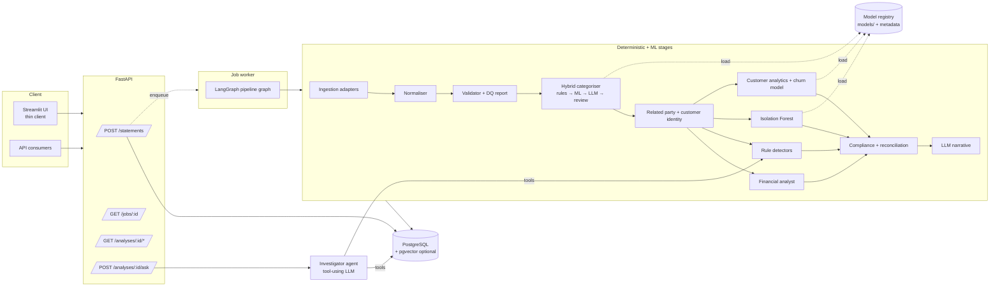

# BSAA Upgrade Guide — ML, Data Engineering & Agentic Architecture

**Repo:** `AayushPrem/investorbankstatementanalysis` · **Base branch:** `sprint-4-prototype`
**Purpose:** Turn the Sprint 1–4 prototype into a production-oriented ML + data engineering + agentic project that is defensible line-by-line in an interview.
**Audience:** Claude Code (primary) and Aayush (reviewer).
**Status of this document:** Written 2 Nov 2026 after a read of the repo and a local test run. File/class names below were verified at that time — re-verify before acting if the code has moved.

> This file supersedes nothing. `IMPLEMENTATION_GUIDE.md` (Sprints 1–4) stays as history. This guide covers the upgrade only.

---

## 0. How to use this guide

**For Claude Code — read this section and §1–§4 at the start of every session.** Then do exactly one phase (§6–§14). Do not start the next phase in the same session.

Per-phase workflow:

1. `git checkout -b <phase branch>` from the latest merged main/sprint branch.
2. Enter **plan mode**. Read the files listed in the phase's *Context*. Propose a plan. Wait for approval.
3. Implement. Keep the full test suite green as you go (`pytest -q`).
4. Run the phase's **Verification** commands and paste real output.
5. Run the reviewer subagent (if installed) and `/security-review`.
6. Update `docs/CHANGELOG_UPGRADE.md` with: what changed, files added/modified/removed, what is verified vs not.
7. Commit. Stop. Report.

**For Aayush:** review every diff before merging. For each phase, read the *Interview talking points* — if you can't explain one, ask Claude Code to explain it before moving on.

---

## 1. Non-negotiable rules

1. **Never fabricate results.** No accuracy, F1, AUC or latency number appears in code, docs or commit messages unless it was produced by a script in this repo that you ran in this session. Paste the command and output.
2. **Synthetic is labelled synthetic.** All data comes from `tools/synthetic_gen.py`. Every metric is reported as "on synthetic data (generator vX)". No claim of real-world performance anywhere.
3. **Deterministic first for anything legally or arithmetically defined.** §269ST structuring, balance reconciliation, burn/runway, NRR, compliance rules → plain code. LLMs never decide fraud, never compute money.
4. **LLM roles are limited to:** fallback categorisation for low-confidence rows, fuzzy related-party matching, narrative/summary generation, and the investigator agent's reasoning. Every LLM path must have a deterministic fallback when `ANTHROPIC_API_KEY` is absent (the current code already does this — preserve it).
5. **No leakage.** ML evaluation splits are grouped (by company, bank, or vendor) or temporal — never random rows from the same statement/template. Thresholds are tuned on validation, reported on test.
6. **Don't delete working functionality.** If replacing something, keep the old path until the new one is tested, then remove it in a separate commit with the reason in the message.
7. **Don't break imports wholesale.** 850+ tests import from top-level packages (`schema`, `adapters`, `pipeline`, `analysis`, `reports`, `jurisdictions`). Do **not** move everything into `src/`. Add new packages alongside (see §4).
8. **No new infrastructure without an ADR** (`docs/adr/NNNN-*.md`) stating the problem it solves and the alternative rejected. Kafka, Airflow, Spark, a standalone vector DB are out of scope (§15).
9. **No PII / financial values in logs.** Log IDs, counts, hashes, durations — never descriptions, names, amounts or balances.
10. **Never claim something works unless you ran it.** "Implemented, not run because X" is an acceptable status.

---

## 2. Current state (verified 2 Nov 2026)

### 2.1 Layout

```
schema/canonical.py          Pydantic v2: CanonicalTransaction, StatementDocument, TransactionCategory (10 classes), ValidationStatus
adapters/                    digital_pdf (pdfplumber), scanned_pdf (pytesseract), image, csv, excel, _column_mapping, base (RawRow, RawStatement, AdapterError)
pipeline/normaliser.py       RawStatement → StatementDocument
pipeline/validator.py        ValidationReport; FAILED blocks the pipeline (ValidationFailedError)
pipeline/related_party.py    RelatedPartyTagger: exact match stage + optional LLM fuzzy match
pipeline/customer_identity.py CustomerIdentityResolver: clean names, aggregator detection, union-find, optional MiniLM embeddings (all-MiniLM-L6-v2) w/ file cache
pipeline/orchestrator.py     Sprint-1-only Orchestrator (adapter→normaliser→validator→categoriser→analyst). NOT used by the demo.
pipeline/batch.py            BatchOrchestrator: asyncio + semaphore, to_thread, failure-isolated
pipeline/versioning.py       AGENT_VERSIONS registry, document_hash, run_id, results persisted to .pipeline_state/
analysis/categoriser.py      Rule layer (ordered regex + debit/credit direction) → Claude Haiku batch fallback (≤50/call)
analysis/financial_analyst.py revenue, burn, runway, MoM growth, monthly stats
analysis/risk.py             6 detectors → list[Flag]: structuring(₹1.5–2L, 7d, ≥4), round_tripping(3–14d), spike_drain(LOO z>2.5), customer_concentration(top-3>60%), round_amount_clustering(>30%), founder_over_extraction(>3× salary or >₹5L/mo); composite score; Haiku narrative
analysis/customer_analytics.py churn (rule), NRR, cohort retention, concentration, regularity alerts, aggregator caveat
analysis/financial_health_alerts.py, compliance.py (+ jurisdictions/india/rules.py), reconciliation.py (claims vs actuals), report_narrative.py, portfolio_narrative.py
reports/                     angel_lens (PDF), vc_lens (1,337 lines), workbench_lens, network_lens (cross-company workbook)
demo/app.py                  Streamlit, 1,664 lines, 4 lens modes
demo/pipeline_runner.py      run_pipeline_on_bytes(): the REAL end-to-end flow (see 2.2)
tools/synthetic_gen.py       1,715 lines. 5 profiles (healthy_saas, burning_startup, ecommerce, restaurant, + 1), HDFC & ICICI layouts, probabilistic red-flag injection with ground-truth labels (category, anomaly_flags, flag_type)
tools/labelling_helper.py, generate_deck.py, generate_architecture_diagram.py
tests/                       ~880 tests + tests/regression/ gold-set suite
```

### 2.2 Real execution flow (`demo/pipeline_runner.run_pipeline_on_bytes`)

```
DigitalPDFAdapter → Normaliser → Validator (gate) → Categoriser(llm) → FinancialAnalyst
→ RelatedPartyTagger(llm_enabled=False) → CustomerIdentityResolver(embedding_enabled=False)
→ RiskAnalyst → CustomerAnalyticsAnalyst → FinancialHealthAnalyst
→ ComplianceAnalyst(IndiaJurisdictionModule) → ReconciliationAnalyst(claims)
→ generate_report_narrative → AngelLens / VC / Workbench PDFs
```

Note: the demo only uses the digital PDF adapter; embeddings and LLM related-party matching are **disabled** in the demo path.

### 2.3 The "12 agents" mapped to code

| # | "Agent" | Module | Type today |
|---|---|---|---|
| 1 | Ingestion | `adapters/*` | Deterministic (+OCR) |
| 2 | Normaliser | `pipeline/normaliser.py` | Deterministic |
| 3 | Validator | `pipeline/validator.py` | Deterministic |
| 4 | Categoriser | `analysis/categoriser.py` | Rules + LLM fallback |
| 5 | Financial analyst | `analysis/financial_analyst.py` | Deterministic |
| 6 | Related-party tagger | `pipeline/related_party.py` | Rules + optional LLM |
| 7 | Customer identity | `pipeline/customer_identity.py` | Rules + optional embeddings |
| 8 | Risk analyst | `analysis/risk.py` | Rules + LLM narrative |
| 9 | Customer analytics | `analysis/customer_analytics.py` | Deterministic |
| 10 | Financial health | `analysis/financial_health_alerts.py` | Rules + LLM |
| 11 | Compliance | `analysis/compliance.py` | Rules + LLM |
| 12 | Reconciliation | `analysis/reconciliation.py` | Deterministic + LLM |
| — | Narrative / lenses | `analysis/*narrative.py`, `reports/*` | LLM + templating |

None of these is an agent in the tool-using sense; they are pipeline stages called in sequence. That's fine — the upgrade keeps them as **stages** and adds one genuine agent (§13).

### 2.4 Known defects (fix in Phase 0/1)

| # | Defect | Evidence |
|---|---|---|
| D1 | `pip install -e .` fails | `pyproject.toml` build-backend `setuptools.backends.legacy` doesn't exist → use `setuptools.build_meta` |
| D2 | 17 errors + 8 failures from missing gold PDFs | `data/gold/**` is gitignored; tests expect `data/gold/hdfc_healthy_saas_5d2a8b.pdf`, `icici_burning_startup_4eb7a0.pdf`; nothing regenerates them |
| D3 | 9 `test_demo_ui.py` failures | `AppTest.from_file("demo/app.py")` resolves relative to the test file → `tests/demo/app.py` |
| D4 | Makefile is Windows-only | uses `.venv/Scripts/...`; `demo` target points at non-existent `demo/streamlit_app.py` |
| D5 | CI hides type errors | `mypy ... \|\| true`; CI never generates the gold set; regression suite never runs in CI |
| D6 | LLM client duplicated 7× | `anthropic.Anthropic()` + hardcoded `"claude-haiku-4-5-20251001"` in categoriser, risk, compliance, reconciliation, financial_health_alerts, report_narrative, portfolio_narrative, related_party |
| D7 | Thresholds hardcoded as module constants | e.g. `_STRUCT_LOWER`, `_SPIKE_Z`, `_CONC_*` in `analysis/risk.py` |
| D8 | Two orchestrators, neither is "the" pipeline | `pipeline/orchestrator.py` (Sprint-1 only) vs `demo/pipeline_runner.py` (full) |
| D9 | Declared-but-unused deps | `sqlalchemy`, `psycopg2-binary` (no DB code); check `tabula-py`, `weasyprint`, `jinja2` usage before removing |
| D10 | Categoriser rules partly fitted to the generator | e.g. rule `r"\bPERSONAL\b$"` commented "Synthetic gen uses …"; the 98.9% figure is measured on the same generator → circular |
| D11 | State is filesystem-based | `.pipeline_state/`, `.cache/` — no DB, no job tracking |
| D12 | Below-target regression metrics (per README) | `risk_recall` ~73% (target 85%), `customer_id_accuracy` ~82% (target 90%) |

---

## 3. Target architecture



Layers (this is the answer to "what are the five layers?"):

| Layer | Responsibility | Tech |
|---|---|---|
| 1. Ingestion & data quality | Parse files, canonicalise, validate, reconcile balances, dedupe, persist | adapters, pydantic, Postgres |
| 2. Enrichment | Categorise, resolve counterparties/customers, related parties | rules + scikit-learn + MiniLM + LLM fallback |
| 3. Analytics & ML | Financial metrics, rule detectors, anomaly model, churn model, segmentation | pandas/DuckDB, scikit-learn |
| 4. Compliance & reconciliation | Jurisdiction rules, claims vs actuals | deterministic |
| 5. Reasoning & reporting | Narratives, lenses, investigator agent | LLM, LangGraph, reportlab |

---

## 4. Target repo layout (additive — keep existing packages)

```
config/                 NEW  settings.py (pydantic-settings), thresholds.yaml, logging.py
llm/                    NEW  client.py — single LLM interface (+ FakeLLM for tests)
db/                     NEW  models.py (SQLAlchemy 2.0), session.py, repositories/, migrations/ (Alembic)
api/                    NEW  main.py, routers/, schemas/, deps.py, errors.py
worker/                 NEW  job runner (polls jobs table)
orchestration/          NEW  graph.py (LangGraph), state.py, stages.py (wraps existing stages)
agents/                 NEW  investigator/ (tools.py, agent.py, prompts.py)
ml/                     NEW
    features/           shared feature builders
    categoriser/        train.py, evaluate.py, infer.py, config.yaml, README.md
    anomaly/            same structure
    churn/              same structure
    segmentation/       same structure
    registry.py         save/load versioned artifacts + metadata.json
datasets/               NEW  build_corpus.py (large synthetic corpus → Parquet), splits.py
schema/ adapters/ pipeline/ analysis/ reports/ jurisdictions/ tools/   KEEP
demo/                   KEEP, refactored into pages/components, calls the API
models/                 gitignored artifacts (+ committed small metadata/model cards)
docs/adr/  docs/ml/  docs/CHANGELOG_UPGRADE.md
docker-compose.yml  Dockerfile  .env.example
```

---

## 5. Phase overview

| Phase | Branch | Outcome | Est. Claude Code time |
|---|---|---|---|
| 0 | `upgrade/p0-baseline` | Green test suite, working build, cross-platform Makefile, honest CI | ~1h |
| 1 | `upgrade/p1-foundations` | Config, single LLM client, structured logging, one canonical pipeline function, UI split | 1.5–2h |
| 2 | `upgrade/p2-data-platform` | Postgres + Alembic, idempotent ingestion, DQ report, jobs, FastAPI, docker-compose | 2–3h |
| 3 | `upgrade/p3-corpus` | Large synthetic corpus with hidden factors, Parquet + DuckDB, leakage-safe splits | 1.5–2h |
| 4 | `upgrade/p4-categoriser-ml` | Hybrid categoriser with confidence routing + honest evaluation | 1.5–2h |
| 5 | `upgrade/p5-anomaly` | Per-account Isolation Forest beside rule detectors | 1–1.5h |
| 6 | `upgrade/p6-churn-segmentation` | Customer churn model + company segmentation | 1.5–2h |
| 7 | `upgrade/p7-agentic` | LangGraph orchestration + investigator agent | 2–3h |
| 8 | `upgrade/p8-hardening-docs` | Security pass, README, ADRs, diagrams, limitations | 1h |

Order matters: P3 must precede P4–P6 (they need the corpus). P2 should precede P7 (agent tools read from DB).

---

## 6. Phase 0 — Baseline & fixes

**Goal:** a reproducible, green starting point. No behaviour changes.

**Context to read:** `pyproject.toml`, `Makefile`, `.github/workflows/ci.yml`, `.gitignore`, `tests/test_demo.py`, `tests/test_demo_ui.py`, `tests/test_validation_gating.py`, `tests/regression/test_gold_set.py`, `tools/synthetic_gen.py` (CLI + how the gold set filenames like `hdfc_healthy_saas_5d2a8b.pdf` are produced).

**Tasks**
1. Fix D1: build backend → `setuptools.build_meta`. Verify `pip install -e ".[dev]"` in a fresh venv.
2. Fix D2: add `scripts/build_gold_set.py` (or a `make gold` target) that deterministically regenerates `data/gold/` with fixed seeds, producing the exact filenames tests expect. Add a session-scoped pytest fixture in `tests/conftest.py` that builds the gold set if missing (cache under `data/gold/`). Do not commit the PDFs.
3. Fix D3: make `AppTest.from_file` use an absolute path built from `Path(__file__).resolve().parents[1] / "demo" / "app.py"`.
4. Fix D4: cross-platform Makefile (detect OS for `bin` vs `Scripts`, or call `python -m pytest/ruff/mypy`), fix `demo` target to `demo/app.py`, add `gold` target.
5. Fix D5: CI generates the gold set, runs the regression suite, and runs mypy **without** `|| true` on `schema/ pipeline/` at minimum (widen as errors are fixed; record the remaining scope in the CHANGELOG).
6. Record the baseline: run the full suite + regression suite, save output to `docs/baseline_2026-11.md` (pass/fail counts, regression metrics as printed). This is the "before" snapshot for interviews.

**Acceptance criteria**
- Fresh clone → `make install && make gold && make test && make regression` all pass on Linux/macOS (and Windows via Git Bash if feasible).
- 0 failures, 0 errors in `tests/` (skips allowed if documented).
- Baseline file exists with real numbers.

**Verification**
```bash
python -m venv .venv && . .venv/bin/activate && pip install -e ".[dev]"
make gold && python -m pytest -q && python -m pytest tests/regression -q
ruff check . && mypy schema/ pipeline/
```

**Interview talking points:** reproducibility (deterministic seeds, regenerated fixtures instead of committed binaries), CI that can actually fail.

**Prompt**
```text
Read UPGRADE_GUIDE.md §0–§4 and §6. Do Phase 0 only on branch upgrade/p0-baseline.
Tasks: fix D1–D5 exactly as listed in §6, add the gold-set build script + conftest fixture, record the baseline in docs/baseline_2026-11.md.
Start in plan mode; list the files you'll change and how the gold filenames are derived before editing.
Finish by running the §6 Verification commands and pasting the real output. Do not change pipeline behaviour.
```

---

## 7. Phase 1 — Foundations

**Goal:** remove duplication and hardcoding; one canonical pipeline entry point.

**Context:** every module listed in D6/D7; `demo/pipeline_runner.py`; `pipeline/orchestrator.py`; `pipeline/batch.py`; `pipeline/versioning.py`; `demo/app.py`.

**Tasks**
1. **Config** (`config/settings.py`, pydantic-settings): `ANTHROPIC_API_KEY`, `LLM_MODEL` (default the existing `claude-haiku-4-5-20251001`), `LLM_ENABLED`, `DATABASE_URL`, `LOG_LEVEL`, `MODELS_DIR`, embeddings toggle. `.env.example` with placeholders only.
2. **Thresholds** → `config/thresholds.yaml` loaded into typed dataclasses. Move every detector/alert/compliance constant (D7). Defaults must equal current values — tests prove behaviour unchanged. Bump nothing in `AGENT_VERSIONS` (pure refactor).
3. **LLM client** (`llm/client.py`): one `LLMClient` protocol with `complete(prompt, *, system, max_tokens, temperature=0) -> str` and `complete_json(..., schema: type[BaseModel])` that validates output with Pydantic and retries once on invalid JSON. Implementations: `AnthropicClient`, `NullClient` (LLM disabled → raises `LLMUnavailable`, callers use existing fallbacks), `FakeLLM` (tests, scripted responses). Replace all 8 call sites (D6). Add timeout, retry with backoff on 429/5xx, and token/latency logging (no prompt content in logs).
4. **Logging** (`config/logging.py`): JSON logs with `run_id`, `stage`, `duration_ms`, counts. Add a redaction helper; grep the codebase for log lines that print descriptions/amounts and fix them.
5. **Canonical pipeline** (`pipeline/run.py`): `run_analysis(input: bytes, filename, *, options) -> AnalysisResult` — the body of `run_pipeline_on_bytes` minus PDF report rendering, choosing the adapter by file type (PDF digital/scanned auto-detect, CSV, Excel, image). `demo/pipeline_runner.py` and `pipeline/batch.py` call it. Mark `pipeline/orchestrator.py` deprecated (keep until P7 replaces it; its tests keep passing).
6. **Split `demo/app.py`** into `demo/pages/` + `demo/components/` without changing UI behaviour (D3 tests must still pass).
7. **Dependency audit** (D9): for each declared dep, grep for imports; remove truly unused ones, move optional heavy ones (sentence-transformers, pytesseract) to extras `[embeddings]`, `[ocr]`. Record decisions in the CHANGELOG.

**Acceptance criteria:** all tests green; `grep -rn "anthropic.Anthropic(" --include=*.py . | grep -v llm/` returns nothing; no hardcoded model string outside config; regression metrics identical to baseline.

**Interview talking points:** single seam for LLM calls (testability, cost tracking, swapping providers), config-driven thresholds (auditability for compliance), why behaviour-preserving refactors are proven by an unchanged regression suite.

**Prompt**
```text
Read UPGRADE_GUIDE.md §0–§4 and §7. Do Phase 1 only on branch upgrade/p1-foundations.
Tasks: config + thresholds.yaml, llm/client.py (Anthropic/Null/Fake) replacing all call sites, JSON logging with redaction, pipeline/run.py as the single entry point with adapter auto-selection, split demo/app.py, dependency audit.
Behaviour must not change: compare regression output against docs/baseline_2026-11.md and paste both.
```

---

## 8. Phase 2 — Data platform (Postgres, idempotency, DQ, jobs, API)

**Goal:** make this a real backend. PostgreSQL is the right choice: relational, transactional, strong constraints, JSONB for evidence blobs, and `pgvector` available later without a new system.

### 8.1 Schema (SQLAlchemy 2.0 + Alembic)

| Table | Key columns | Constraints / indexes |
|---|---|---|
| `documents` | id (uuid), sha256 (char 64), filename, mime, size_bytes, source_format, bank_name, uploaded_at, status | **UNIQUE(sha256)** = idempotency key |
| `accounts` | id, external_account_ref_hash, bank_name, company_name | UNIQUE(external_account_ref_hash, bank_name) |
| `statements` | id, document_id FK, account_id FK, period_start, period_end, validation_status, schema_version | CHECK(period_start ≤ period_end) |
| `transactions` | id, statement_id FK, txn_seq, txn_date, description, debit, credit, balance (NUMERIC(18,2)), currency, rail (UPI/NEFT/IMPS/RTGS/CHQ/CASH/CARD/OTHER), counterparty, customer_id, is_related_party, source_page, source_row, row_hash | CHECK exactly one of debit/credit; UNIQUE(statement_id, txn_seq); INDEX(statement_id, txn_date); INDEX(customer_id) |
| `categorisations` | transaction_id FK, category, source (rule/ml/llm/manual), confidence, model_version, rule_id | one current row per txn + history (or `is_current`) |
| `dq_reports` | statement_id FK, checks JSONB, passed bool | |
| `flags` | id, run_id FK, detector, kind (rule/ml), severity, score, description, evidence JSONB, transaction_ids uuid[] | INDEX(run_id, severity) |
| `runs` | id (= existing run_id from `pipeline/versioning.py`), statement_id FK, agent_versions JSONB, model_versions JSONB, status, started_at, finished_at | |
| `stage_executions` | run_id FK, stage, status, attempt, duration_ms, error | the "agent execution log" |
| `jobs` | id, document_id FK, status (queued/running/succeeded/failed), attempts, last_error, locked_at, locked_by | INDEX(status, created_at) |
| `analysis_outputs` | run_id FK, kind (metrics/customer_analytics/compliance/reconciliation/narrative), payload JSONB | UNIQUE(run_id, kind) |

Money is `NUMERIC`, never float. Keep `Decimal` end-to-end in Python; convert to float only at the presentation/ML-feature boundary.

### 8.2 Data quality report (extend `pipeline/validator.py`, don't replace)
Checks, each producing `{name, passed, severity, count, sample_ids}`: required fields, date parse/range within statement period, duplicate rows (same date+amount+description+balance), debit/credit exclusivity, **running-balance reconciliation** (`prev_balance - debit + credit == balance` within ₹0.01, report break points), opening/closing balance vs header, outlier amounts (robust z on log amount), non-INR currency. Persist to `dq_reports`.

### 8.3 Ingestion semantics
- `sha256(file bytes)` before anything else. If `documents.sha256` exists → return the existing document/job (HTTP 200 with `"duplicate": true`), don't reprocess.
- Whole statement persisted in one DB transaction; a failure leaves no partial rows.
- Validation FAILED → job status `failed` with the DQ report retrievable.

### 8.4 Jobs
Postgres-backed queue: worker claims with `SELECT … FOR UPDATE SKIP LOCKED`, max 3 attempts with backoff, `stage_executions` written per stage. Justification (write ADR-0002): one less system than Celery/Redis; adequate for this throughput; trivially replaceable.

### 8.5 API (FastAPI)

| Method | Path | Notes |
|---|---|---|
| POST | `/v1/statements` | multipart upload (+ optional company name, affiliates, claims JSON); validates type/size; 202 with job_id, or 200 if duplicate |
| GET | `/v1/jobs/{id}` | status, attempts, error, run_id |
| GET | `/v1/runs/{id}/transactions` | paginated, filter by category/date/source |
| GET | `/v1/runs/{id}/categorisation` | coverage by source, review queue |
| PATCH | `/v1/transactions/{id}/category` | manual review override (source=manual) |
| GET | `/v1/runs/{id}/dq` | DQ report |
| GET | `/v1/runs/{id}/flags` | rule + ML flags |
| GET | `/v1/runs/{id}/summary` | financial metrics, customer analytics |
| GET | `/v1/runs/{id}/report?lens=angel\|vc\|workbench` | generated PDF/XLSX |
| GET | `/v1/runs/{id}/executions` | stage execution log |
| GET | `/health`, `/ready` | |

Auth: API key header (`X-API-Key`, hashed in settings) — enough for a demo; say so in limitations. Structured error body `{error: {code, message, details}}`. Max upload size enforced. Pydantic response models. OpenAPI at `/docs`.

### 8.6 Ops
`docker-compose.yml`: postgres:16, api, worker. `Dockerfile` multi-stage. Tests use a Postgres service in CI (or testcontainers); unit tests for repositories, integration tests for upload→job→results, API tests with `httpx`/`TestClient`.

**Acceptance criteria:** uploading the same file twice yields one document; killing the worker mid-job and restarting completes the job; a corrupted-balance fixture produces a failing reconciliation check with the exact break row; all endpoints covered by tests.

**Interview talking points:** content-hash idempotency, NUMERIC for money, `SKIP LOCKED` queue vs Celery, transactional writes, why Postgres over Mongo/Iceberg here (contrast with your Netradyne Iceberg evaluation: analytical lakehouse vs OLTP system of record).

**Prompt**
```text
Read UPGRADE_GUIDE.md §0–§4 and §8. Do Phase 2 only on branch upgrade/p2-data-platform.
Implement §8.1–§8.6: SQLAlchemy models + Alembic migration, DQ report extending the validator, idempotent ingestion, Postgres job queue + worker, FastAPI routes, docker-compose, tests (unit + integration + API).
Write docs/adr/0001-postgres.md and 0002-postgres-job-queue.md. Streamlit should call the API where practical (keep a local fallback for offline demo).
```

---

## 9. Phase 3 — Synthetic corpus at scale

**Goal:** enough, and honest enough, data for P4–P6. Rationale: one statement has too few customers/rows to train churn or segmentation; categoriser/anomaly evaluation needs held-out groups.

**Context:** `tools/synthetic_gen.py` (profiles dict ~L192, `_Company` ~L461, injectors ~L928/L1335, profile generators ~L1356), `tools/labelling_helper.py`.

**Tasks**
1. **Don't rewrite the generator.** Add parameters/hooks:
   - `--n-companies`, `--seed`, profile mix, per-company randomised parameters (revenue scale, # customers 5–200, vendor set).
   - **Narration diversity:** more templates per rail per bank, random reference IDs, truncation at bank-specific widths, casing/spacing noise, merchant-name variants. Keep a `template_id` on each row (for grouped splits). Document that this is done so the evaluation isn't trivially template-matching — and that it's still synthetic.
   - **Hidden-factor churn:** each customer gets latent `health ~ N(0,1)`; monthly churn hazard = sigmoid(a + b·health + c·tenure + noise). Observable precursors are *noisy, partial* proxies (payment delays and amount decline correlate with low health with probability p, not deterministically). Labels never written into narrations.
   - **Extra anomaly injectors** that rules don't target: out-of-pattern vendor amount, first-time large counterparty, off-hours burst. Label them in `anomaly_flags` with `kind=ml_only` so evaluation can separate them.
   - **Write a ground-truth manifest separate from features:** `labels/transactions.parquet` (txn_id, true_category, template_id, anomaly_type), `labels/customers.parquet` (customer_id, churn_month), `labels/companies.parquet` (company_id, profile).
2. `datasets/build_corpus.py`: generate N companies (default 1,000; `--small` = 50 for CI) straight to Parquet (`data/corpus/<version>/transactions.parquet` etc.) — skip PDF rendering for the bulk corpus; render a small PDF subset (e.g. 30) to exercise ingestion end-to-end.
3. `datasets/splits.py`: deterministic split files —
   - categoriser: `GroupShuffleSplit` by **company** + a separate **cross-bank** split (train HDFC → test ICICI) + **unseen-vendor** split (group by counterparty).
   - anomaly: by company.
   - churn: **temporal** (features up to cutoff T, label = churn in (T, T+90d]); train cutoffs earlier than test cutoffs; companies disjoint.
   - segmentation: unsupervised, but hold out companies for stability checks.
4. DuckDB helpers for corpus stats; a `docs/ml/corpus_card.md` (generator version, seed, sizes, class balance, known biases).

**Acceptance criteria:** `python -m datasets.build_corpus --n-companies 1000 --seed 42` reproducible (same hash twice); class balance table in the corpus card; no label column reachable from the feature tables.

**Interview talking points:** latent-variable simulation to avoid circular evaluation, grouped vs temporal splits, data cards, Parquet + DuckDB instead of Spark (benchmark numbers from your machine).

**Prompt**
```text
Read UPGRADE_GUIDE.md §0–§4 and §9. Do Phase 3 only on branch upgrade/p3-corpus.
Extend tools/synthetic_gen.py via parameters (do not rewrite it; existing tests and the gold set must be unchanged for default args), add datasets/build_corpus.py and datasets/splits.py, write docs/ml/corpus_card.md with real stats from a 1,000-company build.
Show me the latent churn design and the new injectors in plan mode before implementing.
```

---

## 10. Phase 4 — Hybrid categoriser (supervised ML)

**Problem:** regex rules don't generalise to unseen narration formats; LLM-for-everything is slow, costly and non-deterministic.

**Model:** scikit-learn `Pipeline`:
- text: `TfidfVectorizer(analyzer="char_wb", ngram_range=(3,5), min_df=2, sublinear_tf=True)` ∪ word TF-IDF on a normalised description (lowercase, strip ref numbers/UPI handles/IFSC, keep merchant tokens).
- structured: is_credit, log1p(amount), rail one-hot, round-amount flags, day-of-month bucket.
- classifier: `LogisticRegression(class_weight="balanced", C tuned)` → wrap in `CalibratedClassifierCV` if calibration curve is poor. Baselines to compare: rules-only, LR, LinearSVC (+calibration), LightGBM/XGBoost on the same features (keep only if it wins on the cross-bank split).
- optional: MiniLM embedding features — evaluate; keep only if it helps unseen-vendor split.

**Routing (`analysis/categoriser.py` v3):**
```
rule match (high-precision rule list only)            → accept, source=rule
else ML p_max ≥ τ_accept                               → accept, source=ml
else LLM available → LLM(category, given top-3 ML candidates) → accept, source=llm
   if LLM ∉ top-3 or LLM unavailable and p_max < τ_review → review queue
```
Thresholds τ in `config/thresholds.yaml`, chosen from the **validation** precision–coverage curve (e.g. lowest τ with precision ≥ 0.97), then reported once on test. Audit the rule list: measure each rule's precision on the corpus; drop/flag rules fitted to generator quirks (D10).

**Evaluation (`ml/categoriser/evaluate.py`) on all three splits:** macro and per-class P/R/F1, confusion matrix (PNG + CSV), precision–coverage curve, % rows per routing source, expected LLM calls per 1,000 txns. Output to `results/categoriser/<model_version>/`. Model card `docs/ml/categoriser.md`.

**Persistence:** `ml/registry.py` saves `model.joblib` + `metadata.json` (git sha, corpus version, split, params, metrics, sklearn version, created_at). `categoriser` bumps to 3.0.0 in `AGENT_VERSIONS`; model version recorded per run.

**Acceptance:** rules-only vs hybrid compared on identical held-out data; numbers come from the script; inference < X ms per 1k rows measured and reported; existing categoriser tests pass or are consciously updated with reasons.

**Talking points:** why char n-grams, why calibrated probabilities enable routing, choosing τ on validation, why the 98.9% was circular and what the honest number is, cost/latency reduction from fewer LLM calls.

**Prompt**
```text
Read UPGRADE_GUIDE.md §0–§4 and §10. Do Phase 4 only on branch upgrade/p4-categoriser-ml.
Build ml/categoriser/{train,evaluate,infer}.py + config.yaml, ml/registry.py, routing in analysis/categoriser.py (v3), rule precision audit, model card.
Run training and evaluation on the P3 corpus for all three splits and paste the actual metric tables. Never write a number you didn't produce.
```

---

## 11. Phase 5 — Transaction anomaly detection (unsupervised)

**Problem:** rule detectors only find named patterns; investors also need "unusual for this company".

**Model:** `IsolationForest` fitted **per account** (min history threshold, else fall back to a pooled model fitted on other companies' standardised features — document which was used). Features (computed only from data up to and including the txn date, no future look-ahead):
- log amount; robust z vs same counterparty history; robust z vs same category; first-seen counterparty flag; counterparty share of month-to-date outflows; 1d/7d transaction velocity; day-of-week, month-end flag; time since last txn with this counterparty.

**Output:** `flags` rows with `kind=ml`, `score`, top contributing features (per-feature deviation ranking, or SHAP TreeExplainer if cheap) as evidence. Severity bands by score percentile. Shown as "investigate", never "fraud".

**Evaluation:** on held-out companies — precision@k (k=10/20/50) and recall@k for injected anomalies, split by `rule-targeted` vs `ml_only` types; compare against a simple z-score baseline; contamination parameter tuned on validation companies. Model card `docs/ml/anomaly.md` with the explicit caveat that it detects synthetic injections.

**Talking points:** unsupervised + rules hybrid, per-entity baselines, no look-ahead features, why precision@k (analyst review budget) rather than accuracy.

**Prompt**
```text
Read UPGRADE_GUIDE.md §0–§4 and §11. Do Phase 5 only on branch upgrade/p5-anomaly.
Build ml/features/transaction_features.py (no look-ahead; add a test proving it), ml/anomaly/{train,evaluate,infer}.py, integrate as a stage writing kind=ml flags, compare with a z-score baseline, model card. Paste real evaluation output.
```

---

## 12. Phase 6 — Churn model & company segmentation

### 12.1 Customer churn (supervised)
- **Unit:** (company, customer, cutoff_date).
- **Label:** customer makes no payment in (cutoff, cutoff+90d] given ≥2 payments before cutoff. Write this definition in the model card verbatim.
- **Features (≤ cutoff only):** tenure, payment count, mean/CV of inter-payment gap, days since last payment vs typical gap, amount trend (slope of last 3 payments), share of company revenue, late-payment ratio, profile one-hot.
- **Models:** LR (baseline, interpretable) vs gradient boosting; `class_weight`/`scale_pos_weight` for imbalance.
- **Split:** temporal + company-disjoint (§9).
- **Metrics:** PR-AUC (primary — imbalanced), ROC-AUC, P/R/F1 at a threshold chosen on validation, precision@top-10% customers, calibration plot. Compare against the existing rule-based churn in `analysis/customer_analytics.py` on the same test set.
- **Integration:** `CustomerAnalyticsAnalyst` gains `churn_risk` per active customer (model only when history ≥ threshold, else rule) — rule churn events remain.

### 12.2 Company segmentation (unsupervised, Network Lens)
- **Features per company:** monthly revenue growth, burn multiple, runway, customer concentration (HHI), revenue volatility (CV), founder-withdrawal share, rail mix, customer count. `StandardScaler` (or `RobustScaler`) after log transforms.
- **Models:** K-Means for k ∈ 2..10 (elbow + silhouette), compare with GMM/agglomerative.
- **Validation:** silhouette; **adjusted Rand index vs hidden generator profiles** (from `labels/companies.parquet`, never used for fitting); bootstrap stability (Jaccard per cluster). Interpret clusters with feature centroids; name them only if they're stable.
- **Integration:** Network Lens shows each company's segment + nearest peers; 2-D PCA plot.

**Talking points:** careful churn label construction, leakage avoidance via cutoff, PR-AUC for imbalance, validating clusters against hidden ground truth rather than storytelling.

**Prompt**
```text
Read UPGRADE_GUIDE.md §0–§4 and §12. Do Phase 6 only on branch upgrade/p6-churn-segmentation.
Build ml/churn and ml/segmentation (train/evaluate/infer/config/model card each), integrate into customer_analytics and network_lens, and compare churn model vs existing rule churn on the same test set. Paste real outputs.
```

---

## 13. Phase 7 — Agentic architecture (LangGraph + investigator agent)

### 13.1 Pipeline graph
- Use LangGraph (check current API docs before coding — it changes; use Context7/docs lookup if installed). ADR-0003 must justify it vs a hand-written DAG: typed shared state, conditional edges, retries, checkpointing/resume, step-level tracing.
- **State** (`orchestration/state.py`): Pydantic model holding ids/references (document_id, run_id, statement_id), stage outputs as DB references or small summaries — not giant transaction lists in state.
- **Nodes** wrap existing stage classes (`orchestration/stages.py`); each node: validate input, run, validate output schema, write `stage_executions`, return state delta.
- **Edges:** validator FAILED → terminate with DQ report; categoriser review-queue > X% → `needs_review` status but continue; LLM unavailable → deterministic fallbacks; analytics stages fan out in parallel where independent (financial analyst, rule detectors, anomaly, customer analytics), join before compliance/reconciliation.
- **Retries:** per-node policy (LLM nodes: retry on transient errors; deterministic nodes: no retry, fail fast).
- **Checkpointing:** Postgres checkpointer so a crashed run resumes at the failed node.
- The worker (P2) invokes the graph. `pipeline/run.py` delegates to the graph; delete `pipeline/orchestrator.py` once its callers/tests are migrated.

### 13.2 Agent/stage registry (document in `docs/agents.md`)

For every node: responsibility, input, output schema, tools, model(s), dependencies, execution condition, error handling, validation, LLM? (yes/no). Only these nodes use an LLM: categoriser fallback, related-party fuzzy match, narratives, investigator.

### 13.3 Investigator agent (the genuine agent)
- Endpoint `POST /v1/runs/{id}/ask` (and a Streamlit chat panel).
- Tool-using loop (Anthropic tool use via `llm/client.py`, or a LangGraph ReAct-style subgraph). **Tools are read-only, typed and scoped to the run:**
  - `query_transactions(filters)` — category/date/amount/counterparty filters, row cap
  - `get_flags(severity?, kind?)`, `explain_flag(flag_id)` — evidence + triggering txns
  - `counterparty_profile(name)` — totals, timeline, related-party status
  - `run_detector(name, params)` — re-run a rule detector with modified thresholds (what-if)
  - `get_metrics()` / `get_customer_analytics()`
- Rules: every numeric claim in the answer must come from a tool result; answer includes cited transaction IDs; max steps (e.g. 8); refuses to label anything "fraud" — uses "warrants review". All tool calls logged to `stage_executions`.
- **Evaluation:** a fixed set of ~30 question/answer pairs over corpus companies with known injected flags (`tests/agent_eval/`): measure tool-call correctness, answer contains the right txn IDs, no hallucinated numbers (checker compares numbers in the answer against tool outputs). Runs with `FakeLLM` scripted in CI for plumbing; with the real model locally (documented, opt-in).

**Talking points:** why most "agents" are deterministic nodes, where reasoning genuinely helps (open-ended investigation), tool design (read-only, scoped, capped), grounding/anti-hallucination check, checkpoint/resume.

**Prompt**
```text
Read UPGRADE_GUIDE.md §0–§4 and §13. Do Phase 7 only on branch upgrade/p7-agentic.
First check the current LangGraph API (docs lookup) and write docs/adr/0003-langgraph.md. Then build orchestration/{state,stages,graph}.py with conditional edges, parallel analytics fan-out, per-node retry, Postgres checkpointing; wire the worker to it; build agents/investigator with read-only tools and the grounding checker; add tests/agent_eval with FakeLLM. Write docs/agents.md (registry table per §13.2).
```

---

## 14. Phase 8 — Hardening & documentation

**Tasks**
1. `/security-review`; fix findings. Check: secrets, PII in logs, upload validation (magic bytes, size), SQL via ORM only, path traversal in report export, API key auth on all non-health routes, dependency pinning (`uv lock` or `pip-tools`).
2. README rewrite: overview, business problem, architecture (Mermaid from §3), stack with one-line justification each, layers & agent registry, ML architecture (per-model summary + link to model cards), data pipeline, DB schema (ER Mermaid), API table, install (docker-compose and local), configuration, running, tests, training/evaluation commands, example workflow (curl), known limitations (§16).
3. ADRs: 0001 Postgres, 0002 job queue, 0003 LangGraph, 0004 scikit-learn over deep learning, 0005 no Spark/Kafka/Airflow/vector DB, 0006 synthetic data strategy.
4. `docs/FEATURES.md` refresh: implemented & verified / implemented not verified / not implemented.
5. `docs/CHANGELOG_UPGRADE.md`: added/modified/removed files per phase.
6. Update `tools/generate_architecture_diagram.py` / deck only if cheap; Mermaid in README is the source of truth.

**Prompt**
```text
Read UPGRADE_GUIDE.md §0–§4, §14, §15, §16. Do Phase 8 on branch upgrade/p8-hardening-docs: security review + fixes, README rewrite, ADRs 0004–0006, FEATURES.md refresh, final CHANGELOG. Every claim in the README must point at a test, script or result file.
```

---

## 15. Out of scope (and the interview answer for each)

| Not doing | Why |
|---|---|
| Spark | Corpus is ~5–10M rows; DuckDB/Polars handle it on a laptop. Benchmark and cite. |
| Kafka | Statements are batch uploads, not an event stream. Would make sense with live Account Aggregator feeds — future work. |
| Airflow | No scheduled DAGs yet; Postgres job queue + cron suffices. Candidate later for nightly retraining. |
| Standalone vector DB | Thousands of merchant names; in-memory numpy or `pgvector` in existing Postgres. |
| Deep learning models | Tabular + short-text problems; linear/tree models are stronger, cheaper and explainable at this data size. |
| Fine-tuning an LLM | No real labelled data; prompt + routing is sufficient. |
| Real customer data | Not available. Everything is synthetic; the generator is part of the deliverable. |

---

## 16. Known limitations to state honestly

- All ML metrics are on synthetic data from this repo's generator; real-world performance is unknown.
- Only HDFC and ICICI layouts are modelled; other banks need adapter work.
- OCR quality on poor scans is not measured.
- API-key auth only; no multi-tenant isolation or encryption-at-rest beyond Postgres defaults.
- Investigator agent quality is evaluated on a small scripted set.
- Regulatory rules reflect the implemented subset of Indian rules, not legal advice.

---

## 17. Definition of done (whole upgrade)

- [ ] Fresh clone → `docker compose up` → upload a sample statement → report retrievable via API.
- [ ] `pytest` (unit, integration, API, ML, agent) green in CI; mypy strict on core packages; ruff clean.
- [ ] Each model has train/evaluate/infer scripts, config, model card, and a results folder produced by its script.
- [ ] Categoriser: rules-only vs hybrid on cross-bank and unseen-vendor splits.
- [ ] Anomaly: precision@k vs baseline, split by injection type.
- [ ] Churn: PR-AUC vs rule baseline, temporal split. Segmentation: ARI + stability.
- [ ] LangGraph pipeline with checkpoint/resume demonstrated by a test.
- [ ] Investigator agent with grounding checker and eval set.
- [ ] README, ADRs, agents.md, model cards, corpus card, CHANGELOG_UPGRADE, FEATURES.md.
- [ ] No secrets, no real statements, no PII in logs (verified by security review).

---

## 18. One-paragraph interview pitch (fill numbers only from results files)

"BSAA ingests Indian bank statements — digital PDFs, scans, CSV, Excel — into a canonical, validated schema in Postgres with content-hash idempotency and running-balance reconciliation. Transactions are categorised by a hybrid router: high-precision rules, then a calibrated TF-IDF logistic-regression model, then an LLM only for the low-confidence tail, then human review — thresholds chosen on a validation precision–coverage curve and evaluated on a held-out bank. Legally defined red flags like §269ST structuring stay deterministic; an Isolation Forest per account surfaces 'unusual for this company' transactions; a churn model predicts customer attrition with a temporal split. A LangGraph pipeline orchestrates it with retries and checkpointing, and an investigator agent answers investor questions using read-only, run-scoped tools with every number grounded in a tool result. Everything is evaluated on a synthetic corpus with hidden latent factors, and I'm explicit that real-world performance is unverified."
